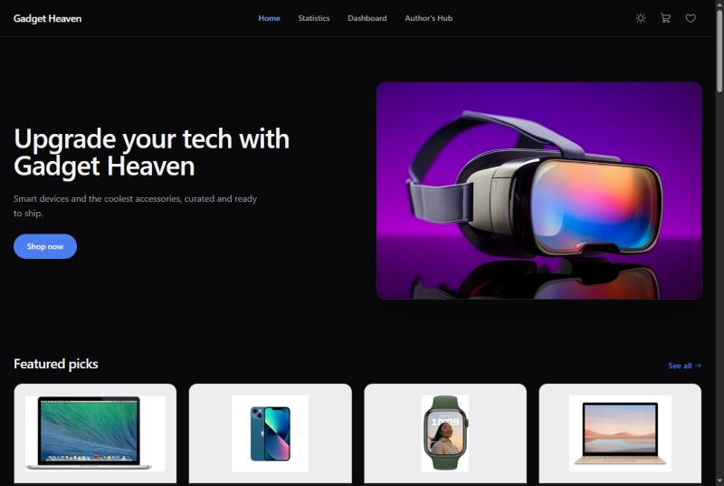
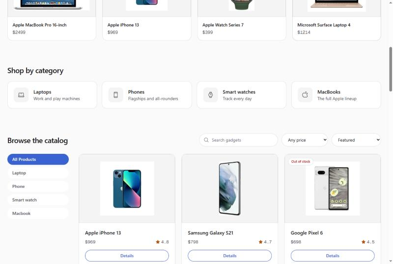
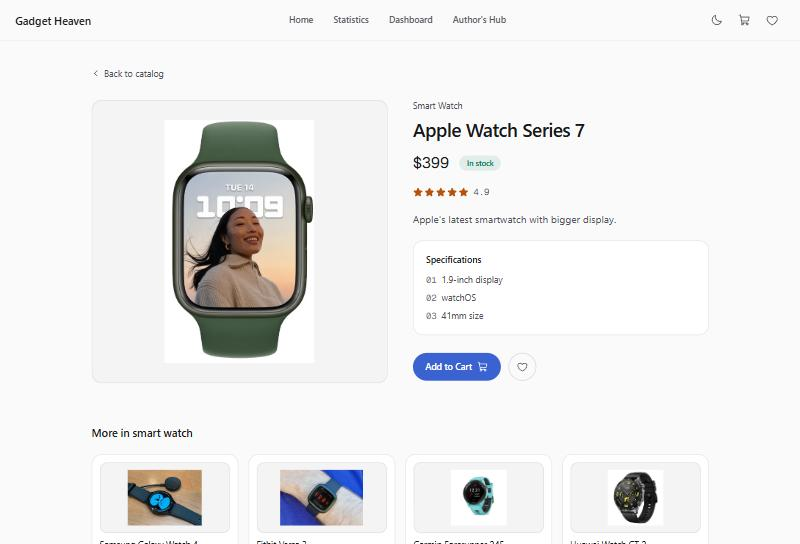
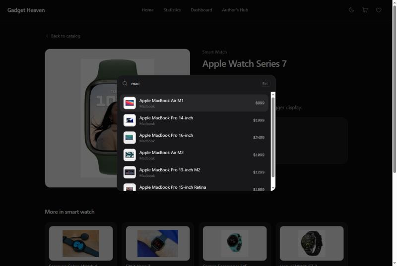
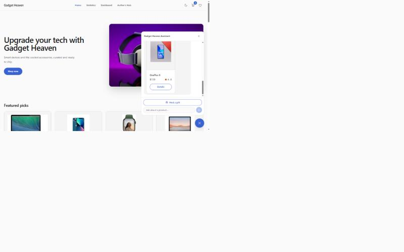

# Gadget Heaven

An e-commerce front end for browsing tech gadgets, built with React, Vite and Tailwind.

**Live:** [gadget-heaven-frontend.netlify.app](https://gadget-heaven-frontend.netlify.app) | [gadget-heaven-frontend.surge.sh](https://gadget-heaven-frontend.surge.sh)



## Features

- Light and dark themes that follow your system setting, with a toggle that persists
- Catalog with search, category, price and sort filters, all synced to the URL so views are shareable
- Command palette (`Ctrl`/`Cmd` + `K`) with fuzzy search
- Cart with quantity controls, plus a wishlist, both saved locally between visits
- Recently viewed and related products
- Price/rating chart on the statistics page
- AI shopping assistant chatbot, with a gift-finder quiz (Netlify only, needs the backend function)









## Built with

React 18 · React Router · Tailwind CSS · Motion · Recharts · Phosphor Icons · localforage · Google Gemini

## Running it

```bash
npm install
npm run dev
```

`npm run build` produces the production bundle in `dist/`.
